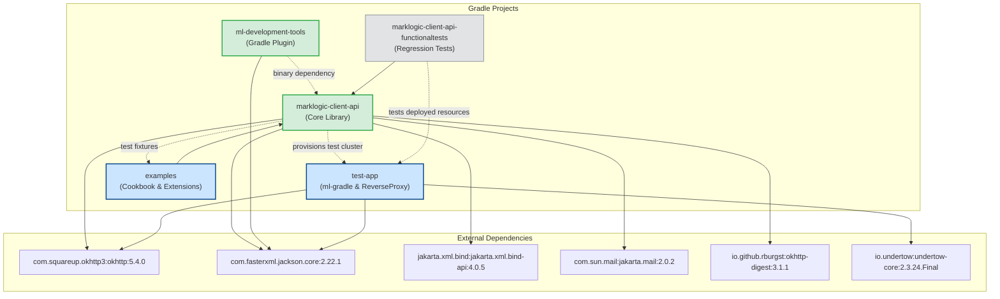

# MarkLogic Java Client API: Executive Summary & Repository Inventory

## 1. Executive Summary

The **MarkLogic Java Client API** (version 8.2.0) is the official enterprise Java driver and high-performance client library maintained by Progress Software Corporation (formerly MarkLogic Corporation) for connecting to MarkLogic multi-model databases via their REST Client and Management APIs.

### Purpose and Scope
The library provides an idiomatic Java interface to execute:
* **Multi-Format Document CRUD**: Read, write, patch, and delete JSON, XML, text, and binary documents.
* **Complex Search & Index Queries**: Full-text structured queries, combined queries, string queries, range queries, and faceted navigation.
* **Relational Row Projection (Optic API)**: A declarative relational query engine that projects documents, lexicons, and triples into tabular rows and executes relational joins, aggregations, and transformations server-side.
* **Semantic Graphs & SPARQL**: Graph store CRUD operations and SPARQL 1.1 graph queries.
* **ACID Multi-Statement Transactions**: Coordinated transactional commits and rollbacks across multiple document mutations.
* **Data Services**: Type-safe client proxies invoking server-side endpoints defined by `.api` declarations.
* **Massive Parallel Batch Movement (DMSDK)**: High-throughput batch ingestion and extraction coordinated directly with physical cluster topology.

### Supported Boundaries & Constraints
* **Runtime JDK**: Java 17 and Java 21 LTS (enforced via Gradle toolchain in `build.gradle` and CI). Support for Java 8 and 11 was discontinued in release 8.0.0.
* **Server Compatibility**: MarkLogic Server 11.x and 12.x.
* **Underlying HTTP Engine**: OkHttp 5.4.0 with OkHttp Digest 3.1.1 and Jakarta Mail 2.0.2 for MIME multipart parsing.
* **Format Parsers**: Jackson 2.22.1, Jakarta XML Binding (JAXB) 4.0.5, Glassfish JAXB Runtime 4.0.6.

---

## 2. Repository Inventory & Module Mapping

The repository is organized as a Gradle multi-project build composed of 5 distinct subprojects:

```
/Users/rsingh/Code/GitHub/java-client-api/
├── build.gradle                               # Root build script configuring subproject toolchains & CVE overrides
├── settings.gradle                            # Subproject module definitions
├── gradle.properties                          # Global versions (8.2.0), OkHttp, Jackson, test host/credentials
├── Jenkinsfile                                # Enterprise CI/CD pipeline (Docker, ARM64, AWS Terraform, Artifactory)
├── docker-compose.yaml                        # Local & CI MarkLogic 11/12 container definitions
├── .env                                       # Docker image references (ubi:latest-12)
├── CONTRIBUTING.md                            # Build & contribution prerequisites (Java 17, mlDeploy)
├── sbom.spdx.json                             # Software Bill of Materials in SPDX JSON format
│
├── marklogic-client-api/                      # CORE CLIENT MODULE (Published to Maven Central)
│   ├── build.gradle                           # Dependencies: OkHttp, Jackson, Jakarta XML/Mail, hashing
│   └── src/
│       ├── main/java/com/marklogic/client/
│       │   ├── DatabaseClient.java            # Primary client interface (extends Closeable)
│       │   ├── DatabaseClientBuilder.java     # Fluent builder with 'marklogic.client.' property resolution
│       │   ├── DatabaseClientFactory.java     # Factory, AuthContexts, SSLHostnameVerifier, HandleRegistry
│       │   ├── Transaction.java               # ACID multi-statement transaction interface
│       │   ├── admin/                         # ServerConfigurationManager (REST server admin)
│       │   ├── alerting/                      # RuleManager (reverse queries / alerting)
│       │   ├── bitemporal/                    # TemporalDocumentManager (valid/system time axes)
│       │   ├── datamovement/                  # Data Movement SDK (DMSDK) interfaces, splitters, listeners
│       │   │   ├── filter/                    # IncrementalWriteFilter, ContentExclusionUtil
│       │   │   └── impl/                      # WriteBatcherImpl, QueryBatcherImpl, DataMovementManagerImpl
│       │   ├── dataservices/                  # Data Services client framework (ExecEndpoint, IOEndpoint)
│       │   │   └── impl/                      # Bulk callers, session state, call execution
│       │   ├── document/                      # DocumentManager interfaces (JSON, XML, Text, Binary, Generic)
│       │   ├── eval/                          # ServerEvaluationCall (xquery, javascript evaluation)
│       │   ├── expression/                    # Generated server function expression builders (Fn, Cts, Xs, Plan)
│       │   ├── extensions/                    # ResourceExtensionsManager, ResourceManager
│       │   ├── extra/                         # Optional DOM4J, JDOM, GSON handles, OkHttpClientConfigurator
│       │   ├── impl/                          # Core internal implementations:
│       │   │   ├── DatabaseClientImpl.java    # Facade delegating to RESTServices
│       │   │   ├── RESTServices.java          # Internal transport SPI interface
│       │   │   ├── OkHttpServices.java        # Concrete OkHttp HTTP transport engine (6,389 lines)
│       │   │   ├── HandleAccessor.java        # Internal package bridge for handles
│       │   │   ├── XmlFactories.java          # ThreadLocal cached, secure XML factories
│       │   │   ├── SSLUtil.java               # Keystore/truststore loader and TLS setup
│       │   │   └── okhttp/                    # OkHttp interceptors, authenticators, URL builder
│       │   ├── io/                            # Document handles (JacksonHandle, DOMHandle, StringHandle, etc.)
│       │   │   └── marker/                    # Handle type tagging marker interfaces
│       │   ├── pojo/                          # PojoRepository and annotations (@Id, @PathIndexProperty)
│       │   ├── query/                         # QueryManager, StructuredQueryBuilder, ValuesDefinition
│       │   ├── row/                           # RowManager, Optic query API execution
│       │   ├── semantics/                     # GraphManager, SPARQLQueryManager
│       │   └── util/                          # EditableNamespaceContext, RequestLogger, VectorUtil
│       └── test/java/com/marklogic/client/    # Unit & Integration test suites
│
├── ml-development-tools/                      # GRADLE PLUGIN & CODE GENERATOR (Published to Gradle Portal)
│   ├── build.gradle                           # Kotlin JVM 2.4.10, Gradle plugin publish, Groovy
│   └── src/main/kotlin/.../tools/
│       ├── gradle/ToolsPlugin.kt              # Gradle plugin 'com.marklogic.ml-development-tools'
│       └── proxy/Generator.kt                 # Generator for Data Services proxies from .api files
│
├── marklogic-client-api-functionaltests/      # FUNCTIONAL / REGRESSION TEST SUITE
│   ├── build.gradle                           # Tasks: runFragileTests, runFastFunctionalTests, runSlowFunctionalTests
│   └── src/test/java/com/marklogic/client/    # Hundreds of end-to-end integration tests
│
├── test-app/                                  # ML-GRADLE TEST DEPLOYER & PROXY
│   ├── build.gradle                           # Applies com.marklogic.ml-gradle, Undertow reverse proxy tasks
│   └── src/main/
│       ├── java/.../test/ReverseProxyServer   # Undertow reverse proxy & Progress Data Cloud token emulator
│       └── ml-config/                         # MarkLogic database, role, user, and app server descriptors
│
└── examples/                                  # EXAMPLES & TEST FIXTURES
    ├── build.gradle                           # Examples dependencies (DOM4J, JDOM, GSON, HTMLCleaner, OpenCSV)
    └── src/main/java/com/marklogic/client/example/
```

### Module Role Matrix

| Module | Build Artifact | Target Users | Primary Responsibilities |
| :--- | :--- | :--- | :--- |
| `marklogic-client-api` | `com.marklogic:marklogic-client-api:8.2.0` | Application Developers, Integrations | Core runtime client, connection lifecycle, document operations, Optic engine, handles, transactions, DMSDK. |
| `ml-development-tools` | `com.marklogic.ml-development-tools` (Plugin) | Build Engineers, Developers | Gradle plugin for compiling `.api` declarations into Java endpoint proxies and test generators. |
| `marklogic-client-api-functionaltests` | Test-only | QA Engineers, CI Pipeline | Regression and functional test suites categorized into fragile, fast, and slow tests. |
| `test-app` | Internal test tool | Developers, CI Pipeline | Deploys test databases and security schemas using `ml-gradle`; includes Undertow reverse proxy emulator. |
| `examples` | Internal library | Developers, Doc Samples | Code samples for cookbooks, custom handles, and advanced features; also acts as a test dependency. |

---

## 3. Module Dependency Direction



---

## 4. Public APIs vs. Internal Implementation

The MarkLogic Java Client API enforces clear boundaries between public APIs and internal classes, although some boundaries rely on conventions:

### Public API Surface
* `com.marklogic.client.DatabaseClient`: Primary client interface extending `java.io.Closeable`.
* `com.marklogic.client.DatabaseClientBuilder`: Fluent builder for creating clients with standard properties.
* `com.marklogic.client.DatabaseClientFactory`: Factory methods, security contexts (`BasicAuthContext`, `DigestAuthContext`, `ProgressDataCloudAuthContext`, etc.), and hostname verifiers.
* `com.marklogic.client.document.*`: Document managers (`JSONDocumentManager`, `XMLDocumentManager`, `BinaryDocumentManager`, `TextDocumentManager`, `GenericDocumentManager`).
* `com.marklogic.client.io.*`: Content handles (`JacksonHandle`, `DOMHandle`, `StringHandle`, `BytesHandle`, `InputStreamHandle`, `JAXBHandle`, `SearchHandle`).
* `com.marklogic.client.query.*`: Query definitions (`StructuredQueryBuilder`, `RawCombinedQueryDefinition`, `StringQueryDefinition`).
* `com.marklogic.client.row.*`: Optic row engine (`RowManager`, `RowRecord`, `RowSet`).
* `com.marklogic.client.datamovement.*`: DMSDK batch operations (`DataMovementManager`, `WriteBatcher`, `QueryBatcher`, `RowBatcher`).
* `com.marklogic.client.dataservices.*`: Data Services callers (`IOEndpoint`, `InputCaller`, `OutputCaller`, `ExecCaller`).
* `com.marklogic.client.semantics.*`: Semantic graph operations (`GraphManager`, `SPARQLQueryManager`).

### Internal Implementation (`*.impl.*`)
* `com.marklogic.client.impl.DatabaseClientImpl`: Concrete facade delegating all operations to `RESTServices`.
* `com.marklogic.client.impl.RESTServices`: Internal SPI interface defining MarkLogic REST endpoints.
* `com.marklogic.client.impl.OkHttpServices`: Monolithic concrete implementation handling OkHttp network operations, retry loops, multipart parsing, and error extraction.
* `com.marklogic.client.impl.HandleAccessor`: Package-private bridge that extracts content from handles without exposing internal setters to client applications.
* `com.marklogic.client.impl.XmlFactories`: Internal ThreadLocal cache of securely configured XML parser factories.
* `com.marklogic.client.impl.SSLUtil`: Internal helper for SSLContext, KeyStore, and TrustStore initialization.
* `com.marklogic.client.impl.okhttp.*`: Interceptors, authenticators, URL builders, and connection socket factories.
* `com.marklogic.client.datamovement.impl.*`: Batcher thread pool executors, task implementations, and cluster topology polling.

> [!WARNING]
> While `DatabaseClient.getClientImplementation()` exposes the underlying transport object (currently `OkHttpClient`), the Javadoc explicitly states that this is an interim escape hatch and unsupported for general application code.

---

## 5. Domain Glossary

* **Handle**: The core I/O abstraction in the client representing an adapter for reading, writing, or buffering specific data formats (`JacksonHandle`, `DOMHandle`, `InputStreamHandle`, `BytesHandle`).
* **Forest**: MarkLogic's primary storage unit containing document records, compressed fragments, lexicons, and inverted indexes. Multiple forests form a database.
* **DMSDK (Data Movement SDK)**: High-throughput, asynchronous batch processing framework (`DataMovementManager`) with topology awareness across multi-node clusters.
* **Optic API**: A declarative functional relational query engine on hierarchical MarkLogic data, exposed via `RowManager` and `PlanBuilder` compiling plans into Abstract Syntax Tree (AST) JSON executed on `/v1/rows`.
* **Data Services**: Server-side endpoints declared with `.api` JSON schemas and invoked via type-safe generated client interfaces (`IOEndpoint`).
* **Server Transform**: A server-side XQuery or JavaScript function executed during document ingestion or read transformations (`ServerTransform`).
* **Bitemporal**: Management of documents across both **Valid Time** (when the event occurred in the real world) and **System Time** (when the event was recorded in the database) via `TemporalDocumentManager`.
* **Progress Data Cloud (PDC)**: Progress Software's cloud-hosted managed MarkLogic DBaaS requiring OAuth/API key bearer authentication via a `/token` endpoint.
* **Optimistic Locking**: Concurrency control mechanism where documents carry an integer or string version corresponding to the HTTP `ETag`. Modifications conditionally succeed using `If-Match` headers.
