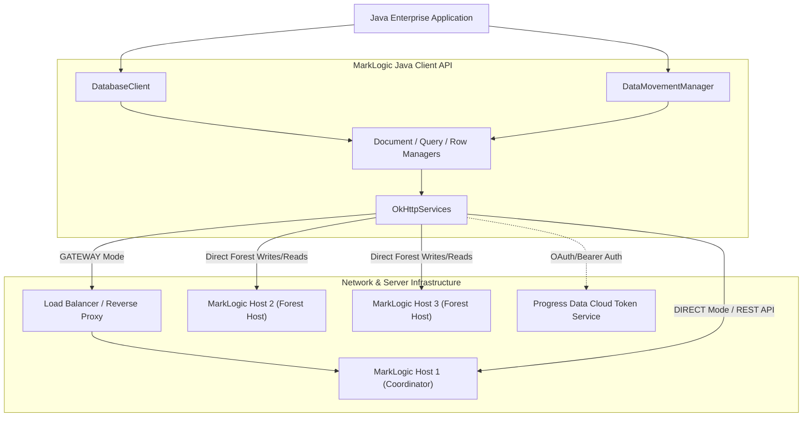
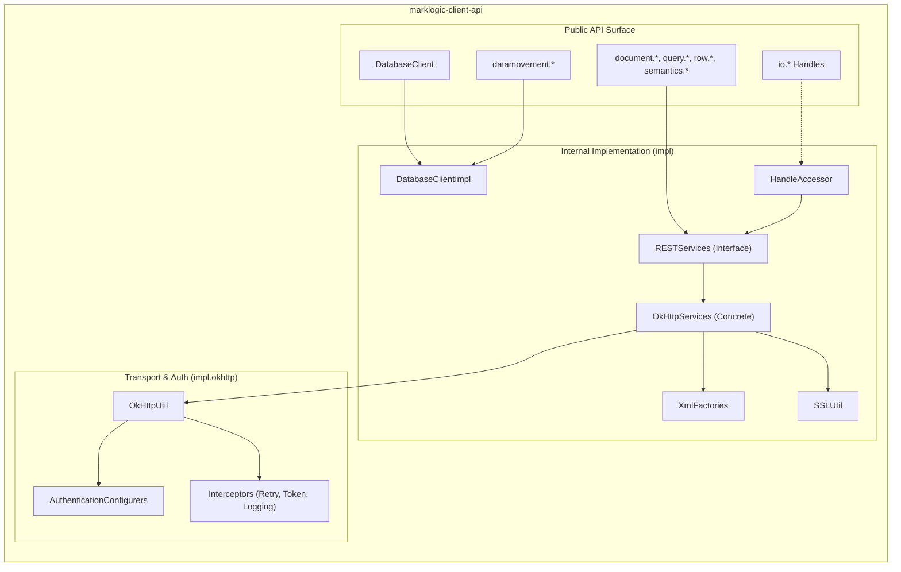
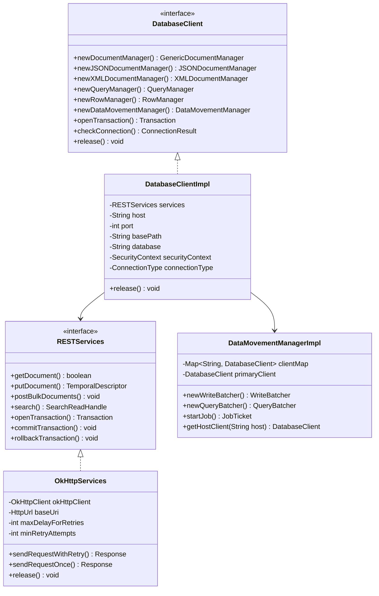
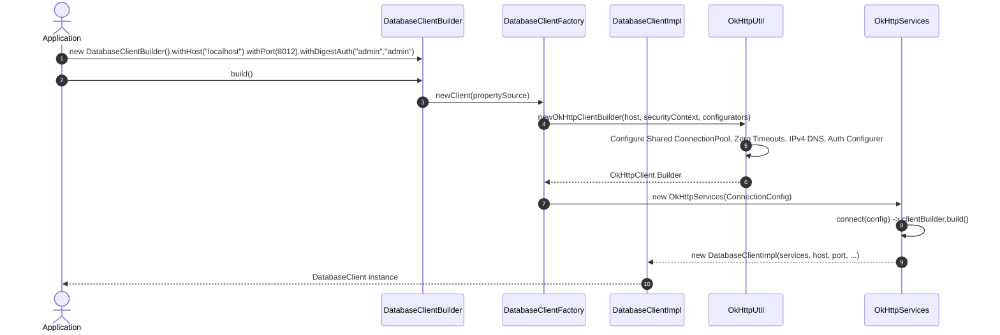

# MarkLogic Java Client API: Architecture and Design

## 1. Architectural Styles & Design Patterns

The MarkLogic Java Client API employs a layered architecture centered around the **Facade Pattern**, **Adapter/Handle Pattern**, and **Producer-Consumer with Natural Backpressure**.

### Core Patterns in Use
1. **Facade Pattern**: `com.marklogic.client.DatabaseClient` acts as the primary unified facade for the database. Rather than exposing low-level HTTP verbs directly to the user, it provides factory methods (`newDocumentManager()`, `newQueryManager()`, `newRowManager()`, `newDataMovementManager()`) that construct domain-specific managers.
2. **Adapter / Handle Pattern**: The client decouples Java data models from wire protocol representations via `com.marklogic.client.io.marker.ContentHandle`. Each handle adapts a concrete representation (`org.w3c.dom.Document`, `com.fasterxml.jackson.databind.JsonNode`, `java.io.InputStream`, `java.io.File`, `byte[]`, POJO) to the HTTP payload streams using `receiveContent` and `sendContent`.
3. **Builder Pattern**:
   * Client construction: `DatabaseClientBuilder` allows fluent assembly of authentication, hosts, ports, SSL, and connection types.
   * Query construction: `StructuredQueryBuilder` provides a type-safe DSL for XML/JSON structured searches.
   * Relational Optic queries: `PlanBuilder` generates complex query ASTs using functional chained methods (`fromView()`, `joinInner()`, `where()`, `select()`).
4. **Producer-Consumer with Natural Backpressure**: In the Data Movement SDK (DMSDK), `WriteBatcherImpl` collects writes into a `ConcurrentLinkedQueue`. Batches are submitted to a `CompletableThreadPoolExecutor` with a bounded queue (`threadCount * 3`). When overloaded, `CompletableRejectedExecutionHandler` leverages `CallerRunsPolicy` to force calling threads to execute batches synchronously, effectively pausing document production.
5. **Topology-Aware Routing**: `DataMovementManagerImpl` queries MarkLogic's cluster forest layout (`/v1/forests`) and dynamically maintains a map of `DatabaseClient` instances connected directly to each physical host holding database forests.

---

## 2. System Context & Runtime Architecture

### System Context Diagram



### Container & Module Architecture



### Major Class & Component Relationships



---

## 3. Component Details & Runtime Lifecycle

### 1. Client Creation & Factory Wiring
* **Builder**: `DatabaseClientBuilder` accumulates properties with the prefix `marklogic.client.`. It resolves the connection string (`username:password@host:port/database`) and creates a property source function.
* **Factory**: `DatabaseClientFactory.newClient(Function<String, Object>)` extracts the connection parameters and calls `DatabaseClientPropertySource.newClient()`.
* **Security Context**: Based on the `authType`, one of several `SecurityContext` implementations is instantiated:
  * `BasicAuthContext`: Uses preemptive `BasicAuthInterceptor`.
  * `DigestAuthContext`: Employs `io.github.rburgst:okhttp-digest` caching authenticators and triggers pre-flight `/ping` requests before streaming non-resendable bodies.
  * `ProgressDataCloudAuthContext`: Obtains OAuth JWT access tokens from `/token` and renews them transparently upon receiving HTTP 401.
  * `OAuthContext`: Emits static `Authorization: Bearer <token>` headers.
  * `KerberosAuthContext`: Negotiates Kerberos/SPNEGO tokens via GSS-API.
  * `CertificateAuthContext`: Configures 2-way mutual TLS using client keystores and custom `X509TrustManager`.

### 2. Transport & Network Engine (`OkHttpServices`)
`OkHttpServices` is the concrete implementation of `RESTServices` and is responsible for:
* **URL Assembly**: Resolves base URLs (`http[s]://host:port/[basePath/]v1/ping`) and relative endpoints using `HttpUrlBuilder`.
* **Zero Timeouts**: OkHttp client builders configure `readTimeout(0, TimeUnit.SECONDS)` and `writeTimeout(0, TimeUnit.SECONDS)` by default so that massive bulk transfers and long-running queries do not terminate prematurely.
* **Connection Pooling**: Uses a single JVM-wide static `okhttp3.ConnectionPool` defined in `OkHttpUtil.java:34`.
* **IPv4 DNS Preference**: Replaces standard system DNS with `OkHttpUtil.DnsImpl`, which filters DNS lookup results to prefer IPv4 addresses over IPv6.

### 3. Initialization and Shutdown Sequences

#### Client Initialization



#### Client Shutdown & Cleanup

```mermaid
sequenceDiagram
    autonumber
    actor App as Application
    participant DBC as DatabaseClientImpl
    participant Services as OkHttpServices
    participant DMM as DataMovementManagerImpl

    alt Standard DatabaseClient Release
        App->>DBC: close() / release()
        DBC->>Services: release()
        Services->>Services: okHttpClient.dispatcher().executorService().shutdownNow()
        Services->>Services: okHttpClient.cache().close() (if configured)
        Services->>Services: okHttpClient = null; released = true
    else DMSDK DataMovementManager Release
        App->>DMM: release()
        loop For Each Cached Client in clientMap
            DMM->>DBC: client.release() (if client != primaryClient)
            DBC->>Services: release()
        end
    end
```

---

## 4. Architectural Boundaries Enforced Only by Convention

Several design contracts are maintained by developer convention rather than language-level enforcement:
1. **Handle Internal Access (`HandleAccessor`)**: Methods like `sendContent()` and `receiveContent()` are `protected` on `BaseHandle` and accessed across packages using `HandleAccessor` in `com.marklogic.client.impl`. Users should not attempt to subclass or manipulate these methods directly.
2. **Manager Concurrency**: `DocumentManagerImpl` contains unsynchronized instance fields (`metadataCategories`, `isMetadataCategoriesModified`, `readTransform`, `writeTransform`). Thread safety is assumed only when configuration is set once before concurrent execution.
3. **Handle Stream Closure**: While `BytesHandle`, `StringHandle`, and `DOMHandle` hold in-memory structures, `InputStreamHandle` and `ReaderHandle` wrap live network streams from OkHttp. Applications must explicitly invoke `.close()` on streaming handles to avoid socket leaks.
