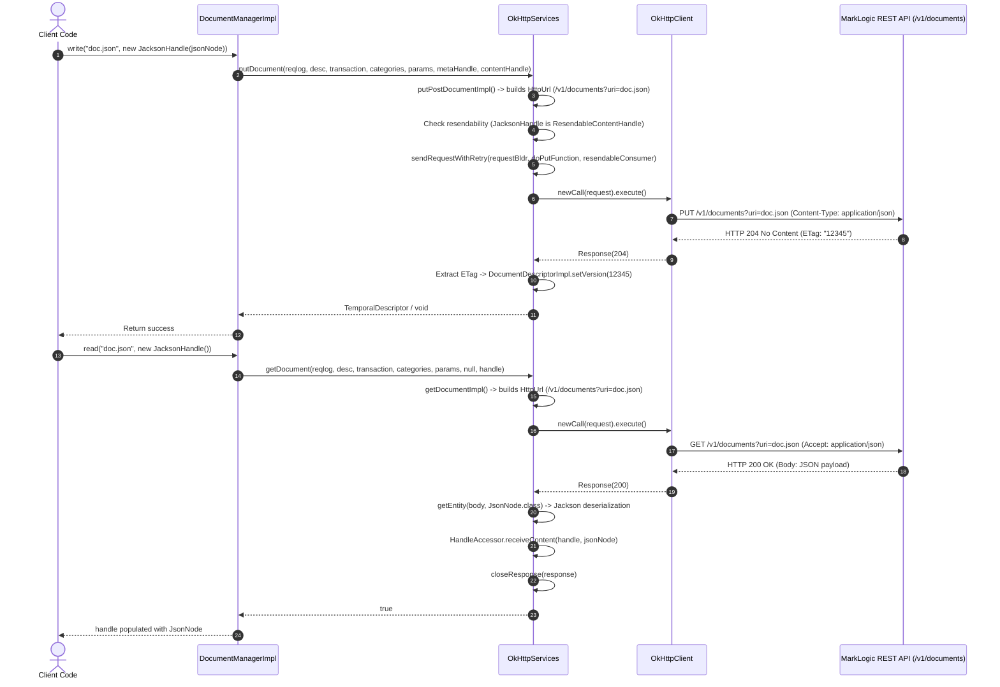
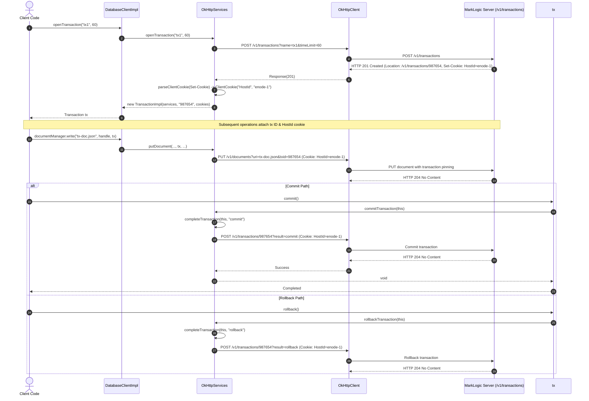
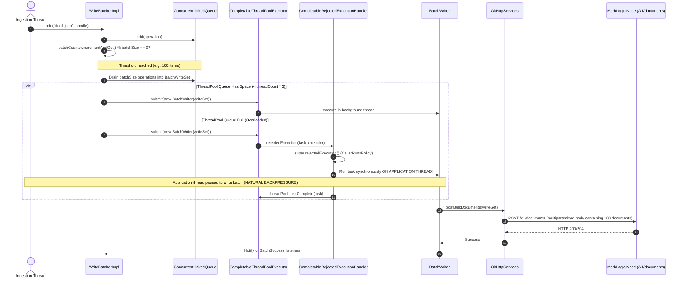

# MarkLogic Java Client API: End-to-End Execution Flows

This document details eight core execution paths through the MarkLogic Java Client API, tracing calls from client APIs through internal implementations, transport serialization, OkHttp network dispatch, and response handling.

---

## Flow 1: Document Write & Read Lifecycle

### Write Flow
1. User invokes `JSONDocumentManager.write(String uri, W handle)` or `write(DocumentDescriptor desc, W handle)`.
2. `DocumentManagerImpl.write()` validates inputs and delegates to `services.putDocument()`.
3. `OkHttpServices.putDocument()` calls `putPostDocumentImpl()` with method `PUT`:
   * Assembles URL: `/v1/documents?uri=<encodedUri>&database=<db>`.
   * Checks handle resendability (`HandleAccessor.isResendable(handle)`). Handles like `JacksonHandle` and `BytesHandle` are resendable; unbuffered `InputStreamHandle` is not.
   * Checks if optimistic locking is active via `desc.getVersion()`. If present, appends `If-Match: "<version>"` header.
   * Dispatches via `sendRequestWithRetry()`.
4. OkHttp sends HTTP `PUT` with `Content-Type: application/json`.
5. Server writes document and responds with HTTP `204 No Content` and `ETag: "12345"`.
6. `OkHttpServices` extracts the `ETag` header, parses the integer version, and updates `DocumentDescriptorImpl.setVersion(12345)`.

### Read Flow
1. User invokes `JSONDocumentManager.read(String uri, R handle)`.
2. `DocumentManagerImpl.read()` invokes `services.getDocument(reqlog, desc, transaction, categories, extraParams, null, handle)`.
3. `OkHttpServices.getDocument()` routes to `getDocumentImpl()`:
   * Sets `Accept: application/json`.
   * Appends transaction ID and transaction cookies if scoped.
   * If `desc.getVersion()` is set, adds `If-None-Match: "<version>"` header.
4. OkHttp executes HTTP `GET /v1/documents?uri=<uri>`.
5. Response parsing:
   * Status 304: Document unchanged, returns `false`.
   * Status 200: Reads `ResponseBody`. If handle expects `JsonNode` (e.g. `JacksonHandle`), Jackson deserializes the stream.
   * Calls `HandleAccessor.receiveContent(handle, content)`.
   * Closes response stream immediately for buffered handles (`JacksonHandle`, `StringHandle`), or leaves it open for streaming handles (`InputStreamHandle`).



---

## Flow 2: Multi-Statement Transaction Commit & Rollback

1. User calls `DatabaseClient.openTransaction(String name, int timeLimit)`.
2. `DatabaseClientImpl` calls `services.openTransaction(name, timeLimit)`.
3. `OkHttpServices` issues `POST /v1/transactions?name=<name>&timeLimit=<seconds>`.
4. MarkLogic creates the transaction and responds with `201 Created`:
   * `Location: /v1/transactions/<txId>`
   * `Set-Cookie: HostId=<hostId>`
5. `OkHttpServices` parses `Set-Cookie` headers into a list of `ClientCookie` objects and instantiates `TransactionImpl(services, txId, cookies)`.
6. Subsequent operations passing this `Transaction` instance automatically attach `?txid=<txId>` and set the `Cookie: HostId=<hostId>` header, pinning requests across load balancers to the specific coordinator node.
7. To commit, user invokes `transaction.commit()`:
   * Calls `services.commitTransaction(this)`.
   * `OkHttpServices` executes `POST /v1/transactions/<txId>?result=commit` with `HostId` cookie.
   * MarkLogic commits the transaction and returns `204 No Content`.
8. To rollback, user invokes `transaction.rollback()`, which posts `result=rollback`.



---

## Flow 3: DMSDK Batch Ingestion with Backpressure

1. User calls `DataMovementManager.newWriteBatcher()`.
2. Configures `withBatchSize(100)` and `withThreadCount(8)`.
3. Calls `dataMovementManager.startJob(writeBatcher)`.
4. App threads invoke `writeBatcher.add(uri, handle)`:
   * Document write operations are appended to `ConcurrentLinkedQueue queue`.
   * Counter `batchCounter.incrementAndGet()` tracks total added documents.
5. When `batchCounter % batchSize == 0`:
   * Drains 100 documents into a `BatchWriteSet`.
   * Constructs a `BatchWriter` task and submits it to `CompletableThreadPoolExecutor`.
6. Backpressure Throttling:
   * The executor queue is bounded to `threadCount * 3` (e.g. 24 tasks).
   * If the queue fills up, `CompletableRejectedExecutionHandler` (subclass of `CallerRunsPolicy`) triggers.
   * The application calling thread itself runs `BatchWriter.run()` synchronously, temporarily blocking further `.add()` calls until the batch finishes.
7. In `BatchWriter.run()`:
   * Selects target host client from `DataMovementManagerImpl.getHostClient()`.
   * Calls `services.postBulkDocuments()` sending a `multipart/mixed` HTTP POST.
   * On success, dispatches `WriteBatchListener.processEvent(batch)`.
   * On failure, dispatches `WriteFailureListener.processFailure(batch, throwable)` (e.g. `HostAvailabilityListener`).



---

## Flow 4: DMSDK Parallel Forest Querying & URI Export

1. User calls `dataMovementManager.newQueryBatcher(query)`.
2. Configures `withBatchSize(1000)` and listeners (`ExportListener` or `UrisToWriterListener`).
3. Calls `dataMovementManager.startJob(queryBatcher)`.
4. `QueryBatcherImpl.startQuerying()`:
   * Discovers cluster forests via `ForestConfiguration`.
   * Spawns a dedicated worker task per forest in the database.
5. Each forest task queries its assigned forest directly:
   * Invokes `queryMgr.uris(queryMethod, query, filtered, handle, start, afterUri, forest.getForestName())`.
   * Sends `POST /v1/internal/uris` directly to the host hosting that forest.
6. As URIs stream in, batches of `batchSize` are dispatched to `onUrisReady` listeners (`ExportListener`, `DeleteListener`).
7. Failover Handling:
   * If a node crashes, `HostAvailabilityListener` catches the connection error.
   * Temporarily blacklists the host, checks the secondary host for forest replication, and reschedules the query task starting from `forestResultsSoFar + 1`.

---

## Flow 5: Optic API Relational Plan Execution

1. User builds plan using `rowManager.newPlanBuilder()`:
   ```java
   PlanBuilder op = rowManager.newPlanBuilder();
   Plan plan = op.fromView("main", "employees")
                 .where(op.gt(op.col("salary"), op.xs.intVal(50000)))
                 .select(op.col("name"), op.col("salary"));
   ```
2. User calls `rowManager.resultRows(plan)`.
3. `RowManagerImpl.resultRows()`:
   * Serializes the Optic plan AST into a JSON representation (`PlanBuilderSubImpl.export()`).
   * Appends execution parameters (`output-format=json`, `structure=object`, `datatype-style=row`).
   * If `rowManager.withUpdate(true)` was set, targets `/v1/rows/update`; otherwise `/v1/rows`.
4. `OkHttpServices` executes `POST /v1/rows` with the plan JSON payload.
5. Server executes Optic pipeline across index lexicons and streams back multipart or JSON row sets.
6. Client wraps the stream in a `RowSet<RowRecord>` iterator.

---

## Flow 6: Authentication & Connection Establishment

1. User configures client via `DatabaseClientBuilder`:
   ```java
   DatabaseClient client = new DatabaseClientBuilder()
       .withHost("ml.example.com")
       .withPort(8012)
       .withCloudAuth("api-key-xyz", "base/path")
       .build();
   ```
2. `OkHttpUtil.newOkHttpClientBuilder()` installs the matching authenticator:
   * **Digest Auth**: Registers `DigestAuthenticator` and `AuthenticationCacheInterceptor`. For the first request on each thread, `OkHttpServices` pings `/ping` to seed the digest nonce challenge before streaming large payloads.
   * **Progress Data Cloud**: Instantiates `TokenAuthenticationInterceptor` and `DefaultTokenGenerator`. Calls `POST /token` on port 443 with `grant_type` and `key` to obtain a JWT bearer token.
   * **Kerberos**: Instantiates `HTTPKerberosAuthInterceptor` which requests a SPNEGO service ticket using Java GSS-API.
   * **Mutual TLS (Certificate)**: Loads keystore and truststore via `SSLUtil`, configuring an initialized `SSLContext` and `X509TrustManager`.

---

## Flow 7: Failure, Retry, and Recovery

1. Client executes a request through `OkHttpServices.sendRequestWithRetry()`.
2. The request enters `RetryContext`:
   * Evaluates if the HTTP status is in `RETRYABLE_STATUS_CODES` (502 Bad Gateway, 503 Service Unavailable, 504 Gateway Timeout).
   * Checks if elapsed time is within `maxDelayForRetries` (default 120,000 ms) or attempts are under `minRetryAttempts` (default 8).
3. If 503 is returned:
   * Checks `Retry-After` header. If absent, calculates an exponential backoff delay with random jitter (`calculateDelay(retry)`).
   * Verifies that the request content is resendable (`resendableConsumer.accept()`). If non-resendable, throws `ResourceNotResendableException`.
   * Sleeps for the computed backoff duration and retries.
4. If retries are exhausted, throws `FailedRetryException`.
5. For non-retryable errors:
   * Status 401: Throws `UnauthorizedUserException` (or auto-renews token in cloud auth).
   * Status 403: Throws `ForbiddenUserException`.
   * Status 404: Throws `ResourceNotFoundException`.
   * Status 412: Throws `ContentWrongVersionException` (optimistic lock mismatch).
   * Status 500 / other: Passes XML or JSON error body to `FailedRequest.getFailedRequest()`, extracts server error code and formatted message, and throws `FailedRequestException`.

---

## Flow 8: Client Shutdown & Resource Cleanup

1. User invokes `DatabaseClient.close()` or `release()`.
2. `DatabaseClientImpl.release()` delegates to `OkHttpServices.release()`.
3. `OkHttpServices`:
   * Sets `released = true` (future calls immediately throw `IllegalStateException`).
   * Calls `okHttpClient.dispatcher().executorService().shutdownNow()` to interrupt pending requests and terminate worker threads.
   * Closes HTTP disk cache if present (`okHttpClient.cache().close()`).
   * Sets `okHttpClient = null`.
4. In DMSDK, calling `DataMovementManager.release()` iterates over all host clients created for cluster forests and invokes `.release()` on each non-primary client.
